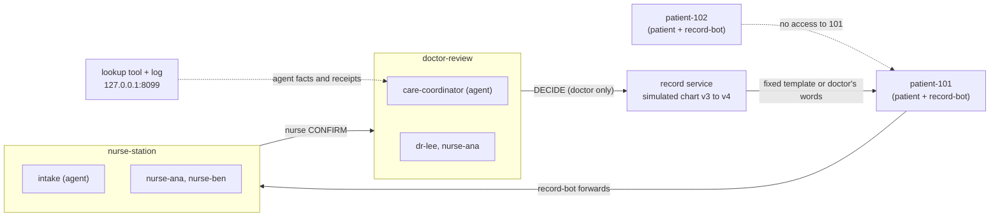

# Lantern

**An AI care team built on Switch: agents carry the work, doctors decide, and nothing changes hands until the next nurse says accept.**

- **Demo video (2:52):** https://youtu.be/QR7r84tyBlo
- **Blog:** [Hashnode](https://sivasuryachandran.hashnode.dev/the-nurse-was-right-we-refused-her-anyway) · [dev.to](https://dev.to/siva_surya_f555745c8bbca8/the-nurse-and-doctor-sent-the-same-message-only-one-changed-the-chart-3ad0)
- **#HowISwitch post:** https://x.com/siva_surya35077/status/2119108582230896946

> **Fictional data. Not for clinical use.** Every patient, staff account and record here is invented. Lantern gives no medical advice, is not HIPAA-compliant and is not an EHR. The "chart" is a small simulated chart inside Lantern.

**The video is a recorded fallback, not a live four-agent Switch run.** The record service, ✓ checks, refusals, chart changes and owner changes are real, from one run against a local Mattermost. All four agents in it are rule-based stand-ins, captioned on screen, and the people are played by a script. The Jira and Calendar items were created by hand for the demo, so the narration's line that Lantern's hooks created them is wrong. Details: [`recordings/final/shotlist_actual.md`](recordings/final/shotlist_actual.md) and [`cutlist.md`](recordings/final/cutlist.md).

## Run it

### Setup

Python 3.11+ and PyYAML.

```bash
git clone https://github.com/sivasuryachandran/Lantern && cd Lantern
python3 -m venv .venv && .venv/bin/pip install pyyaml
```

On Windows use `.venv/Scripts/python` and Git Bash for the shell scripts.

### Tests

```bash
.venv/bin/python -m unittest discover -s tests   # 98 tests, no network
```

Last recorded output: [`recordings/tests.txt`](recordings/tests.txt).

### Demo driver

No Mattermost needed:

```bash
.venv/bin/python scripts/demo_offline.py         # the whole of Case 17 in your terminal
```

Against a real Mattermost, such as the one Switch Console runs for you ([full setup](docs/SWITCH_SETUP.md)). The setup script prints a throwaway password for the fictional accounts:

```bash
MM_URL=http://localhost:8065 MM_TEAM=lantern MM_ADMIN_TOKEN=<admin token> .venv/bin/python scripts/setup_mattermost.py
export MM_URL=http://localhost:8065 MM_TEAM=lantern LANTERN_TEST_PASSWORD=<printed password>
scripts/start.sh                                 # record service and dashboard on 127.0.0.1:8099
```

Mattermost's port is chosen by Switch Console, so set `MM_URL` and `MM_TEAM` to match. Then, in a second terminal with the same exports:

```bash
.venv/bin/python scripts/demo_driver.py          # Case 17: plays the people, and scripted stand-ins for intake and care-coordinator
.venv/bin/python scripts/demo_driver.py --real   # plays the people only; your Switch agents must be running
```

For a whole day on the ward, as in the video, run the stand-in agents and the scenario script instead:

```bash
.venv/bin/python -m lantern simagents            # leave running
.venv/bin/python scripts/ward_scenarios.py       # in another terminal
```

`scripts/reset_demo.sh` resets between runs. The read-only dashboard is at `http://127.0.0.1:8099/`.

## How Lantern uses Switch

Switch turns each channel into a room where people and AI teammates share one history. Lantern is nine of those rooms, plus a small deterministic service that holds the rules. **Agents notice and carry. People decide. Code enforces.**



| Room | Members in [`config/roles.yaml`](config/roles.yaml) | Purpose |
| --- | --- | --- |
| `patient-101` … `patient-104` | that patient, record-bot | bedside tablet. **No agent is a member** |
| `nurse-station` | nurses, intake, care-coordinator, record-bot | flag, confirm, hand off, accept |
| `doctor-review` | Dr. Lee, Nurse Ana, care-coordinator, record-bot | evidence with receipts, then the decision |
| `orders` | doctor, nurses, record-bot | feed of every chart change, written by the service |
| `medication` | nurses, doctor, record-bot | feed of every `GIVEN`, written by the service |
| `room-service` | Sam and Rita, nurses, record-bot | tray and turnover tasks that only room service can close |

- **Room membership is the privacy model.** Which rooms an agent may enter is a setting, not a prompt it might ignore. On a local demo server, Switch's connection account, the admin user and any viewer account can also be in patient rooms; a real deployment would have to remove them.
- **Addressing rules back it up.** Each agent's "Who can talk to your agent" lists only its staff rooms, so `@intake` from a patient in Mattermost's Town Square is refused by Switch.
- **Agents work in the staff's own threads.** intake flags a possible mismatch and quotes the patient; care-coordinator carries the case to the doctor, cites chart facts through a logged lookup tool and briefs the next nurse. People can read every step.
- **The rules live outside the agents.** [`lantern/service.py`](lantern/service.py) alone changes the chart. A `DECIDE` counts only from a listed doctor, in `doctor-review`, as an unedited reply in that case's thread, naming the current chart version, on a nurse-confirmed case. A ✓ means a citation matches the service's own lookup log, not that it is medically right.
- **Patients see only** fixed messages, the doctor's own words, or a labelled translation.

**What ran where:**

| | Status |
| --- | --- |
| `intake`, `care-coordinator` as real Switch agents | Passed the full Case 17 three runs in a row on Nov 4, with refusals tested live. Not recorded. Later rebuilt on OpenCode in Switch Console, and not answering Mattermost messages at recording time; cause not found |
| `interpreter`, `scribe` | Code stand-ins only ([`lantern/simagents.py`](lantern/simagents.py)) |
| Jira and Google Calendar | Real items created by hand through connectors. The service's own hooks ([`lantern/integrations.py`](lantern/integrations.py)) are tested against fakes only |
| Clinical review | None. Questions are ready in [`docs/NURSE_REVIEW.md`](docs/NURSE_REVIEW.md) |

## Lantern × Wispr Flow

Nurses don't have free hands, so every staff command is one short line designed to be spoken with [Wispr Flow](https://wisprflow.ai), which works in any text box with no integration code:

```text
CONFIRM Case 17
GIVEN Case 17 anti-nausea (fictional) 18:10
NOTE Case 17: She ate half of it and said the soup was too salty.
REMIND Case 17 in 20 min check she ate
ADVICE Case 17: She can have a regular diet today, her procedure moved to Thursday.
HANDOFF Case 17 open: confirm she ate without nausea
ACCEPT Case 17
```

- **Whisper Mode** fits a 7:00 handoff beside sleeping patients.
- **Dictionary and Snippets** are planned so "at intake" becomes `@intake` and a spoken trigger inserts the exact command.
- **Dictation is just a faster keyboard.** A spoken `DECIDE` from a nurse is refused like a typed one, because the service checks who posted, not how the words got there. Dictated `ADVICE` is recorded as advice, with a draft `DECIDE` the doctor must send herself.

**Status:** this is the design. Dictation was not recorded in the demo; the driver typed those commands, and the Wispr bubbles in the video are labelled re-enactments. The feature-by-feature plan is in [`docs/WISPR.md`](docs/WISPR.md).

## Designed, not yet built

Instructions are written for six more agents. **None has been created in Switch Console or run.** Some need rooms that don't exist yet.

| Agent | Would do |
| --- | --- |
| [`handoff-briefer`](docs/agents/handoff-briefer.md) | Brief the incoming nurse on what is still open when a `HANDOFF` is pending |
| [`dietary-coordinator`](docs/agents/dietary-coordinator.md) | Check trays against diet changes in `room-service` |
| [`housekeeping-coordinator`](docs/agents/housekeeping-coordinator.md) | Help room service track turnover work |
| [`bed-manager`](docs/agents/bed-manager.md) | Check a room's history before a patient is placed (needs a `bed-management` room) |
| [`discharge-planner`](docs/agents/discharge-planner.md) | Coordinate the steps after a doctor signs a discharge (needs a `discharge` room) |
| [`pharmacy-liaison`](docs/agents/pharmacy-liaison.md) | Read the `medication` feed and raise questions for staff (needs a staff room) |

The scenarios behind them, and what is built versus designed, are in [`docs/HOSPITAL_SCENARIOS.md`](docs/HOSPITAL_SCENARIOS.md).
