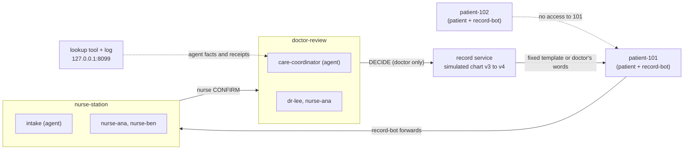

# Lantern

**What was said. What was confirmed. Who owns what's next.**

> **Fictional data. Not for clinical use.** Every person and record here is invented. Lantern gives no medical advice, is not HIPAA-compliant, and is not an EHR. The "chart" is a small *simulated chart* inside Lantern.

Lantern keeps a shared record of concerns, decisions and handoffs beside the clinical chart. When what a patient says conflicts with their chart, the concern moves through Switch rooms from the patient to the nurse to the doctor, and comes back to the patient as an answer a clinician confirmed. The next nurse then has to accept the follow-up at shift change.

The rule underneath: **only a clinician's verified decision changes the record.**

## How Switch is used (and what breaks without it)

- **Nothing carries the case between rooms.** care-coordinator, a real coding agent in a Switch room, summarizes the evidence in `doctor-review` and answers the doctor from the live chart. Without Switch there is no teammate in that room.
- **Nothing stops an agent joining a patient room.** Isolation is Switch room membership and addressing rules, not a prompt: no agent is a member of any patient room, each agent's "Who can talk to your agent" lists only its staff rooms (so `@intake` from a patient in Mattermost's Town Square is refused by Switch), and patient 102's account cannot open patient 101's.
- **Nothing makes the agent accountable.** care-coordinator gets chart facts only from a lookup tool (`GET /chart/<patient>/<entry>`) that is plain code: every call is logged with a lookup number, entry, chart version, time and agent. When it cites `[proc-1 v3 · lookup #31 = Thu 9:00]`, record-bot replies in the thread with a card built from the log, not from the agent's words, marked ✓ verified or ⚠ (no matching lookup, wrong value, wrong entry/version/agent/patient, or stale after the chart changed). Only cited source facts are checked; anything else the agent writes is shown as unverified interpretation.

### Who does what

- **Agents do the teamwork, through Switch.** intake asks the nurse; care-coordinator briefs the doctor and the incoming nurse. They are members of the staff rooms and reply in the same threads as the people.
- **Code handles the patient edge and the checks.** record-bot forwards patient messages, starts the case threads, sends the fixed patient templates and the doctor's own words, and posts short verdicts (a ✓ or ⚠ under an agent's cited facts). It uses no model and makes no judgments.
- **Evidence receipts are how a good teammate works, not distrust.** Every claim the agent makes comes with its source, the way a good colleague's would; the system just shows that the source says what the claim says.

## Rooms



record-bot is plain code and is in every room. No agent is in a patient room.

## Case 17 in one minute

1. Patient 101's bedside tablet (`patient-101`): "Can't wait for breakfast. Dr. Lee said it's fine now that my procedure moved." The chart says `diet = NPO` (v3).
2. record-bot forwards it to `nurse-station`. **intake** (a Switch agent) posts a *possible* discrepancy card quoting the patient exactly. The service checks the quote against the original post, opens Case 17, and only then tells the patient "Your care team is checking this."
3. The nurse replies `CONFIRM Case 17` in the thread. record-bot opens the Case thread in `doctor-review`; **care-coordinator** (a Switch agent) summarizes the evidence from the chart with citations.
4. Dr. Lee replies `DECIDE Case 17 v3 diet=regular` plus `EXPLAIN: ...`. The service verifies author, role, room, thread, edit status and chart version, bumps the simulated chart to v4, and posts her words to the patient word for word, with "Following up: nurse-ana".
5. At shift change the outgoing nurse posts `GIVEN` and `HANDOFF`; the incoming nurse posts `ACCEPT`; the patient's owner line becomes "Following up: nurse-ben".

Run it with no Mattermost at all:

```bash
.venv/bin/python scripts/demo_offline.py
```

## Trust model

Agents extract and route. A small deterministic **record service** (`lantern/service.py`) is the only thing that changes the simulated chart, says "resolved", or posts to a patient.

- A claim card is rejected unless its `quote` is an **exact substring** of the original patient post, it names an active order of that topic, and it cites the current chart version. Status can only be `possible_discrepancy`.
- A decision counts only if it is a post by a user listed as `doctor` in `config/roles.yaml`, in `doctor-review`, as a reply in that case's doctor thread, unedited, in the `DECIDE` format, naming the current chart version, on a nurse-confirmed case. Otherwise it is ignored or rejected with a message.
- Everything a patient can ever see from the service is a fixed template (`PATIENT_TEMPLATES`) or a doctor's own words.
- The service matches on Mattermost `user_id`s resolved from `roles.yaml` at startup, never on display names.
- Every side effect is keyed and idempotent: restarting creates no duplicate case, thread root or patient message.

The record keeps *said*, *chart*, *draft*, *decision* and *task* entries separate. `GIVEN` entries are stored apart from orders and never change them.

## Setup

Python 3.11+ and PyYAML.

```bash
python3 -m venv .venv && .venv/bin/pip install pyyaml
.venv/bin/python -m unittest discover -s tests        # the must-pass tests, no network needed
```

On Windows use `.venv/Scripts/python` and Git Bash for `scripts/start.sh`.

With Switch and its bundled Mattermost running, follow [docs/SWITCH_SETUP.md](docs/SWITCH_SETUP.md): create the two agents (instructions in `docs/agents/`), restrict who can address them, run `scripts/setup_mattermost.py`, then `scripts/start.sh` (or `python -m lantern run`). Mattermost's port is chosen by Switch Console, so set `MM_URL` and `MM_TEAM` to match.

```bash
.venv/bin/python -m lantern timeline 101 patient   # or nurse / doctor
.venv/bin/python -m lantern chart 101
```

## Tests

`tests/test_must_pass.py` covers the plan's seven must-pass tests plus case numbering and reject/handoff edge cases (24 tests); `tests/test_extras.py` adds evidence receipts, the lookup endpoints, buttons, the clip and the timeline views (26 more, 50 in total). Test 1's "three casual mentions" is checked at the service level (each card opens a possible, never confirmed, case); whether the *LLM* produces the card for each phrasing is checked live with `scripts/check_intake.py`.

## Layout

| Path | What |
| --- | --- |
| `lantern/service.py` | Record service: SQLite, chart versions, case states, decision verification |
| `lantern/bot.py`, `lantern/chat.py` | record-bot poller and the Mattermost REST client (stdlib only) |
| `lantern/timeline.py` | Role-scoped shared timeline |
| `config/roles.yaml`, `data/` | Roles, room membership, synthetic charts |
| `docs/agents/` | Switch agent instructions |
| `scripts/` | Mattermost setup, offline demo, live intake check |

## Database and backend

SQLite (`lantern.db`) holds the simulated charts (every version), cases, events, decisions, lookups and the audit log. `python scripts/seed_demo_db.py` loads four fictional patients and three earlier cases (14 to 16), so the first live case is still Case 17; `scripts/start.sh` does this automatically for a new database.

**Mission-control dashboard:** with the bot running, open `http://127.0.0.1:8099/` (add `?key=<LANTERN_API_KEY>` if you set one). It shows the case pipeline lighting up stage by stage, the simulated chart with version history (old orders struck through), the evidence ledger (✓ current / ⚠ stale), the case timeline and the command audit with refusals in red. It polls the read-only API every 1.5 seconds; press **P** for presentation mode.

`python -m lantern run` also serves a **read-only** backend on `127.0.0.1:8099` (set `LANTERN_BIND` to change, `LANTERN_API_KEY` to require an `X-Api-Key` header): `/healthz`, `/api/patients`, `/api/patients/<id>/chart` and `/chart/versions`, `/api/cases` and `/api/cases/<n>`, `/api/lookups`, `/api/audit`, and `/api/timeline/<id>?role=nurse|doctor[&format=html]`. Nothing in the API can change the record, and it refuses the patient role. Only patients 101 and 102 have chat accounts; 103 and 104 exist as backend data only.

## Optional pieces

All are off unless configured.

| Piece | How to enable | Notes |
| --- | --- | --- |
| Buttons (Confirm / Reject / Accept) | `LANTERN_ACTION_URL=http://<host reachable from Mattermost>:8099/action` | A click becomes the same typed command with Mattermost's verified `user_id`, so every check still applies. Mattermost must allow that host in `AllowedUntrustedInternalConnections`. The doctor's `DECIDE` stays typed because it carries her own words. |
| Jira | `JIRA_URL`, `JIRA_EMAIL`, `JIRA_TOKEN`, `JIRA_PROJECT`, optional `JIRA_ACCOUNTS='{"nurse-ben":"<accountId>"}'` | One task per case on RESOLVED; reassigned on ACCEPT. Use a test project. |
| Google Calendar | `GCAL_TOKEN` (OAuth bearer), optional `GCAL_CALENDAR_ID` | One follow-up event on RESOLVED. Use a test calendar. |
| Recorded clip | `python -m lantern clip 101 data/clip-example.json` | Takes a timestamped transcript (from any transcriber); claims cite `clip@seconds`. No audio playback or transcription is built in. |

Calendar and Jira are called directly by the record service rather than as Switch agent tools; neither is the record and neither approves anything.

## Verification status

- `python -m unittest discover -s tests`: 51 tests, no network.
- `scripts/live_e2e.py`: Case 17 against a real Mattermost with scripted stand-ins for the agents.
- **Live with the real Switch agents** (Switch Console 0.40.1, Mattermost bundled, both agents on Claude Code, Nov 4):
  - `scripts/check_intake.py`: all three casual phrasings opened a possible-discrepancy case.
  - Full Case 17 (patient, intake card, nurse CONFIRM, care-coordinator summary with ✓ evidence cards, doctor DECIDE, chart v3 to v4, patient told) passed three runs in a row on a fresh database.
  - Refused live: DECIDE from a nurse, from a patient, as a top-level post, and with a stale chart version. Other refusals (edited post, another case's thread) are covered by unit tests only.
  - GIVEN, HANDOFF and ACCEPT moved ownership from nurse-ana to nurse-ben, with a care-coordinator brief.
  - patient-102's account gets 403 reading patient-101. No agent is a member of either patient room (checked against Mattermost membership). Switch's own refusal of an agent in a patient room was not tested: its Console does not list rooms an agent is not in.
  - Both agents were also in Mattermost's default Town Square, where the patient accounts are members and Mattermost cannot remove anyone. Each agent's "Who can talk to your agent" is therefore set to custom rules (users any, agents none, rooms nurse-station for intake, nurse-station and doctor-review for care-coordinator). `@intake` from patient-101 in Town Square then got: "You're not permitted to direct messages to me in this room — my operator has restricted who can address me here." Case 17 passed again with these rules on.
- Not yet run: live buttons, and live Jira/Calendar calls (request shapes are unit-tested against a fake HTTP layer only).
- Known limit: a crash in the middle of a command can drop that command's follow-up message; restarts never duplicate anything.
- `scripts/demo_driver.py` and `scripts/live_e2e.py`, run again on Nov 6 against a local Mattermost with the full loop, the dashboard and the lookup tool; both the intake and care-coordinator accounts were scripted stand-ins in that run.
- Not done: the nurse review. See below.

## Nurse review

We prepared the questions for a 15-minute review by a working nurse ([docs/NURSE_REVIEW.md](docs/NURSE_REVIEW.md)), but **the review was not done before submission**, so there is no clinician feedback or quote here. The workflow, wording and roles are our own assumptions and have not been validated by a nurse or doctor. Everything is fictional data, not for clinical use.

## Docs

[Recording guide](docs/RECORDING_GUIDE.md) · [Demo script](docs/DEMO_SCRIPT.md) · [Nurse review questions](docs/NURSE_REVIEW.md) · [Blog draft](docs/BLOG.md) · [#HowISwitch draft](docs/HOWISWITCH.md) · [Submission checklist](docs/SUBMISSION.md) · `scripts/start.sh` starts record-bot against the local Mattermost.

A nurse or doctor can post `TIMELINE 101` in nurse-station or doctor-review to get the role-scoped timeline from record-bot; `python -m lantern timeline 101 nurse --html > timeline.html` makes a standalone page for the last demo scene.

Team split and the Claude Code handoff: [docs/TEAM_SPLIT.md](docs/TEAM_SPLIT.md), [docs/HANDOFF_FOR_CLAUDE_CODE.md](docs/HANDOFF_FOR_CLAUDE_CODE.md).
