> **Fictional patients, a simulated chart, human roles played by our team.** Lantern is a hackathon prototype for Flip the Switch. It is not a clinical system and gives no medical advice.

Nurse Ana typed the correct order. The right patient, the right change, the right reason, even the doctor's explanation, word for word.

Lantern refused her.

Moments later Dr. Lee typed the same words, character for character. The chart moved from version 3 to version 4, and the patient got an answer.

That is not a bug. It is the entire idea.



> **What you're watching: the recorded fallback.** The agents in this video are rule-based stand-ins, labelled on screen. The real Switch path, with `intake` and `care-coordinator` running as Switch agents, passed this same case three runs in a row on Nov 4. The record service, checks and refusals in the video are real. [Exactly what is real, below.](#the-night-our-agents-went-quiet)

**[Read the code](https://github.com/sivasuryachandran/Lantern)** · By Siva Surya Chandran

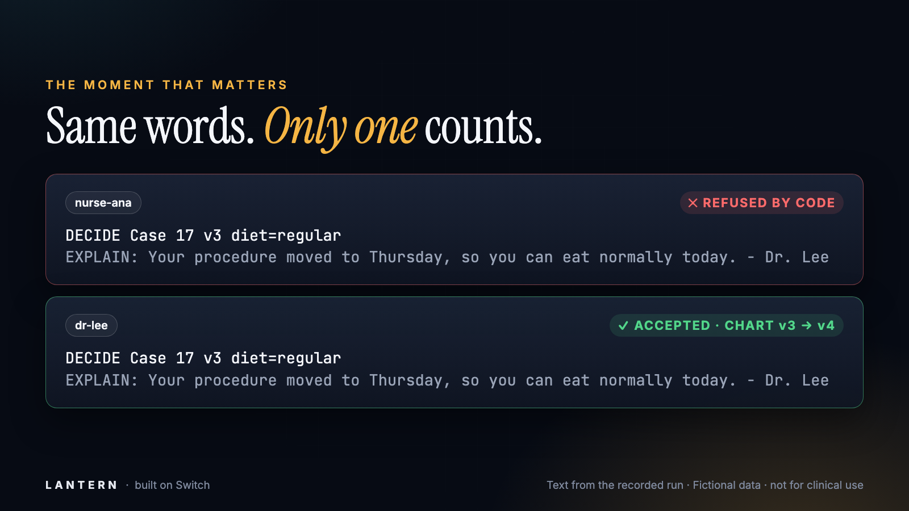

## The most dangerous sentence on a ward

It is 6:40 in the morning. Ana's shift ends at seven. A patient has just told her bedside tablet:

> "Can't wait for breakfast. Dr. Lee said it's fine now that my procedure moved."

Her chart says **NPO**: nothing by mouth.

Nobody here did anything wrong. A doctor said something reasonable, the chart has not caught up, and in twenty minutes a different nurse takes over. The patient may be right. The chart may be right. And the next person to walk in will not know there was ever a question.

The Joint Commission defines a hand-off as *"a transfer and acceptance of patient care responsibility achieved through effective communication"* ([AHRQ PSNet summary](https://psnet.ahrq.gov/issue/inadequate-hand-communication)). Read that again and stop at **acceptance**. Sending a message is not transferring a responsibility. Its alert on hand-offs lists wrong-site surgery, treatment delays, falls and medication errors among reported adverse events, and cites a 2016 study estimating that communication failures played a part in about 30% of malpractice claims ([Sentinel Event Alert 58, PDF](https://jointcommission.org/-/media/tjc/documents/resources/patient-safety-topics/sentinel-event/sea_58_hand_off_comms_9_6_17_final_(1).pdf)).

The world does not need another AI that writes things down. We built for the moment *after*: when the words and the record disagree, and somebody has to notice, the right person has to decide, and the next shift has to know who owns what's left.

**What was said. What was confirmed. Who owns what's next.**

## We kept AI out of the room that matters most

Lantern is a ward built on [Switch](https://github.com/sandbox-quantum/switch): nine private rooms where people and AI teammates share one history. The most important design decision we made was not a prompt. It was a membership list.

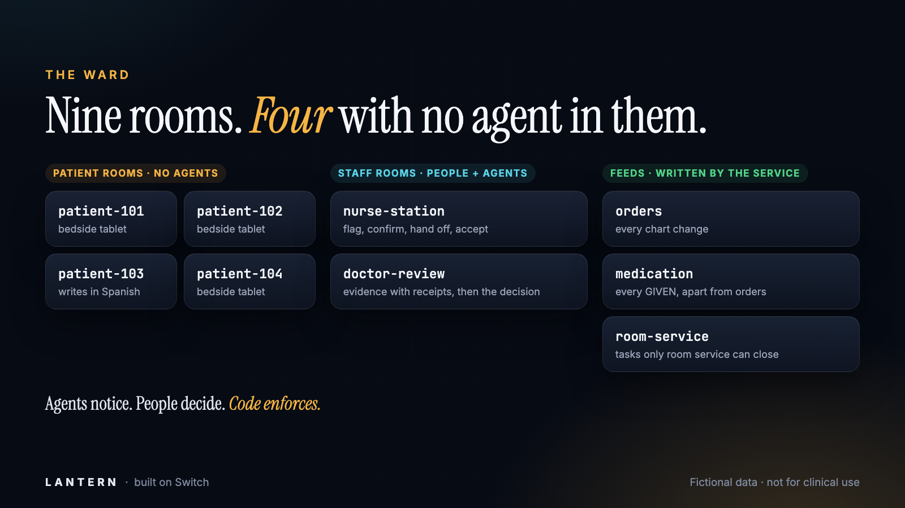

| Who | Their job | What they can never do |
| --- | --- | --- |
| **intake** (agent) | Spots a possible mismatch and quotes the patient exactly | Diagnose, or enter a patient room |
| **care-coordinator** (agent) | Carries the case to the doctor with cited chart facts, briefs the next nurse | Recommend a decision or change an order |
| **interpreter**, **scribe** (agents) | Translate both ways, file dictated notes | Turn a translation or a note into an order |
| **record-bot** (plain code) | Opens cases, checks every claim, posts the ✓ | Improvise. It has no model in it |
| **Nurses** | Confirm, record medicines, hand off, accept | Change an order |
| **Dr. Lee** | Decides | Decide outside the case thread |
| **Room service** | Close tray and turnover tasks | Touch the chart |

The AI in this hospital is not allowed to say "resolved". Only the record service can. Agents notice and carry. People decide. Code enforces.

## Case 17, step by step

**1. The bedside.** Patient 101's remark lands in her room. record-bot forwards it to `nurse-station`, keeping the original post id.

**2. The agent notices, and the code checks the agent.** intake posts a *possible* discrepancy against `ord-diet-1 · NPO · v3`. If its quote is not an exact substring of what she really wrote, the service throws the card away. An agent cannot put words in a patient's mouth.

**3. A person clarifies.** Case 17 opens. Only now does the patient get a fixed message that the team is checking. Ana replies `CONFIRM Case 17`.

**4. Evidence, with receipts.** record-bot opens the case in `doctor-review` and @mentions care-coordinator, which pulls chart facts through a logged lookup tool and cites each one. Then it says the sentence we are proudest of: *"I am not recommending a decision."*

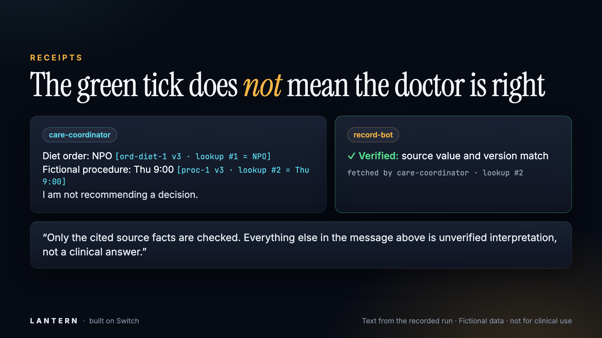

Here it is in the room. Note Ana's `DECIDE` at the bottom of the thread, which changes nothing:

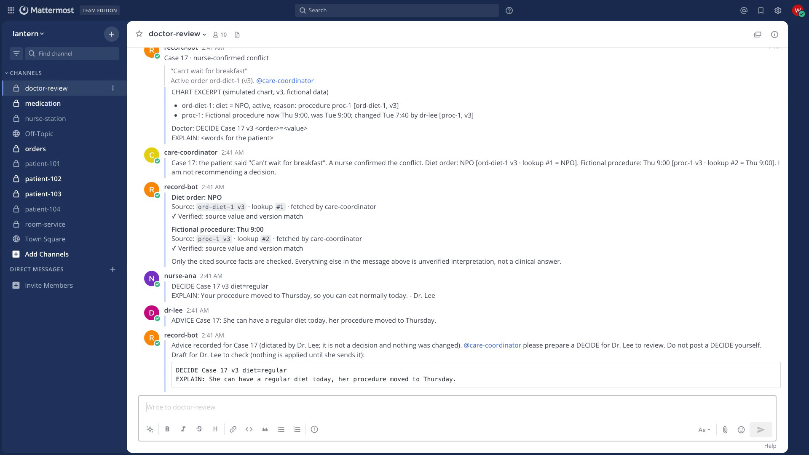

**5. The refusal.** Ana's `DECIDE` fails the first check. There is no argument to win, no prompt to jailbreak, nothing to persuade. The chart stays at v3 and the refusal goes on the audit log.

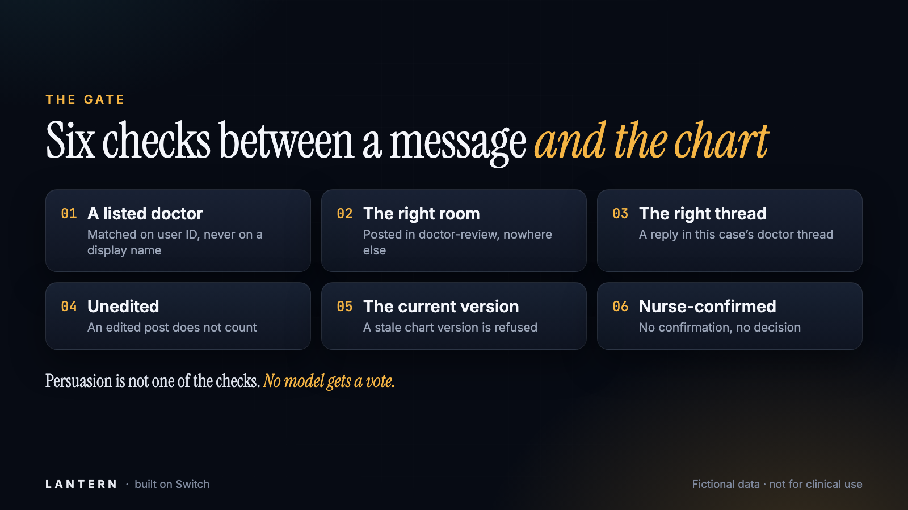

**6. Advice is not a decision.** Dr. Lee says: *"She can have a regular diet today, her procedure moved to Thursday."* Lantern files that as `ADVICE`, offers a draft `DECIDE`, and changes nothing. A sentence said out loud does not become an order until she sends it herself.

**7. The chart moves.** Her `DECIDE` passes all six checks. v3 becomes v4, and Patient 101 receives Dr. Lee's own words, attributed, never an AI's paraphrase.

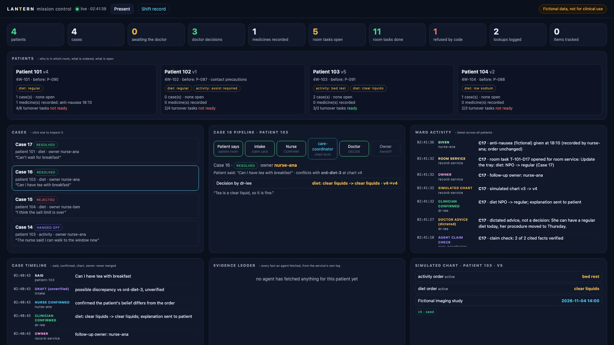

## One decision, and the whole ward moves

**The kitchen hears about it.** The diet change opens a tray task in `room-service`. Ana tries `DONE`: refused. Sam posts `DONE T-101-D17`: closed, with his name on it.

**The language barrier gets a witness.** Patient 103 writes *"El fisioterapeuta dijo que puedo sentarme en la silla para el almuerzo."* The nurse sees the English beside the original, and the doctor's answer returns in Spanish, labelled as a translation, under the doctor's original words. It can be read aloud. It can never change an order.

**Two entries for one medicine get flagged, not hidden.** Acetaminophen recorded at 08:00 and again at 12:10 raises a possible double entry. Both stay visible. `GIVEN` is a record of what a nurse says happened; it never rewrites an order, and Lantern does not judge the dose.

**A curious patient hits a wall.** Patient 102 asks about Case 17 and is told Lantern only shares updates about their own care. Their account gets a 403 on the other room.

**Mission control watches everything and can change nothing.** Fourteen read-only panels: patients, cases, evidence, chart versions, medicines, room tasks, translations, reminders, tracking and the command audit.

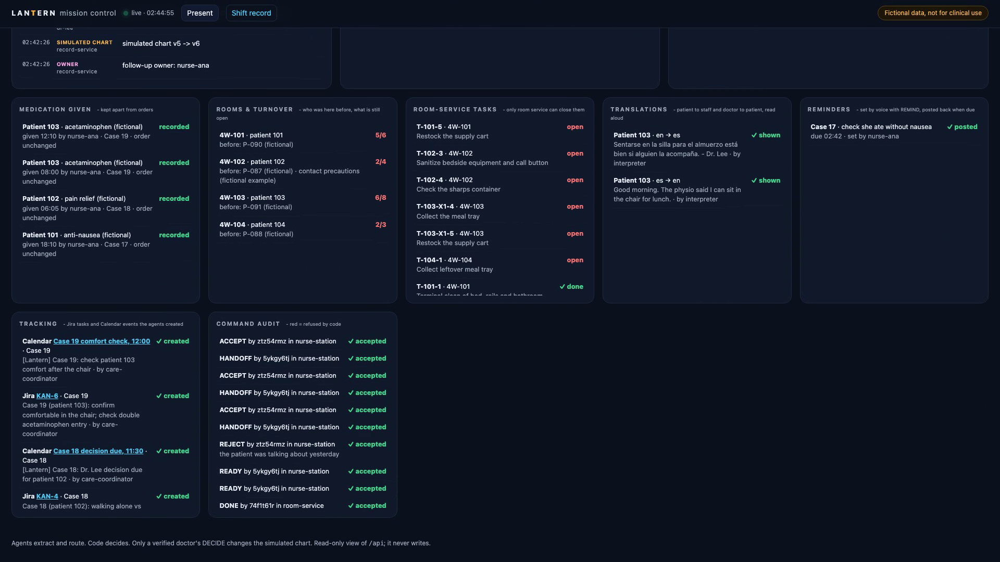

## Seven o'clock: where hospitals lose things

Ana posts `HANDOFF`. The coordinator briefs Ben on what's open. And then, nothing happens. The case still belongs to Ana, because Ben hasn't said so.

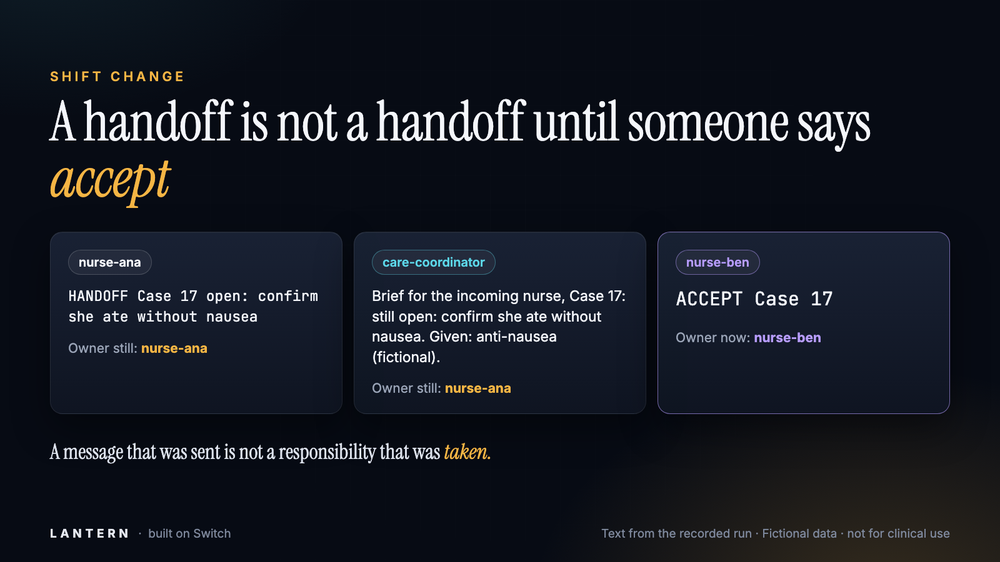

One word from Ben, and the owner changes on the record.

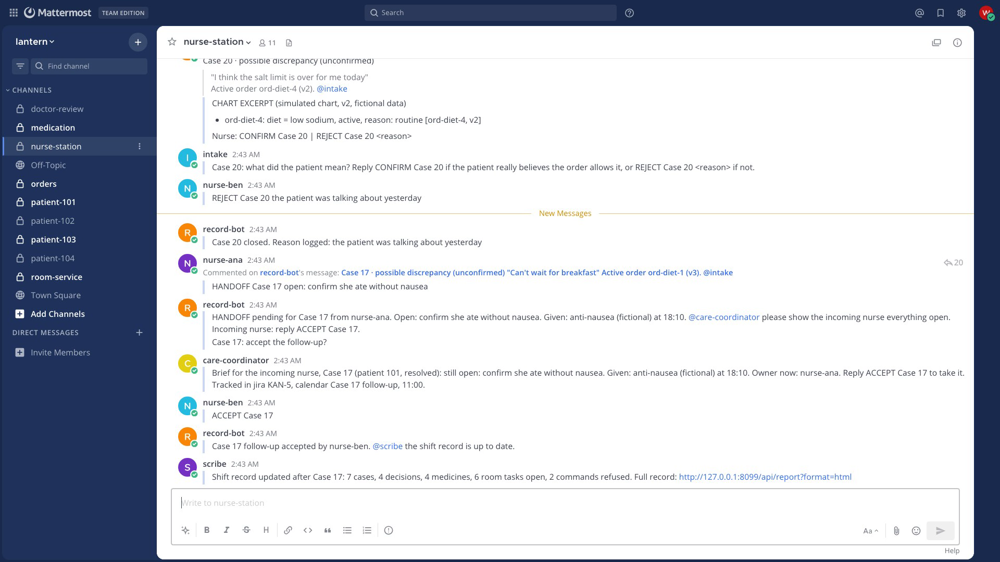

## The night our agents went quiet

Here is the part most demo posts would leave out.

On Nov 4, `intake` and `care-coordinator` ran as real agents in Switch Console and passed the full case, three times in a row, with refusals tested live. That run was not recorded. Then we rebuilt them on OpenCode for the final version, and by recording night they were not answering Mattermost messages. We did not find out why in time. `interpreter` and `scribe` have only ever run as code stand-ins.

So the video is a **recorded fallback**: rule-based stand-ins play all four agents, and every frame says so. It is not a live four-agent Switch run.

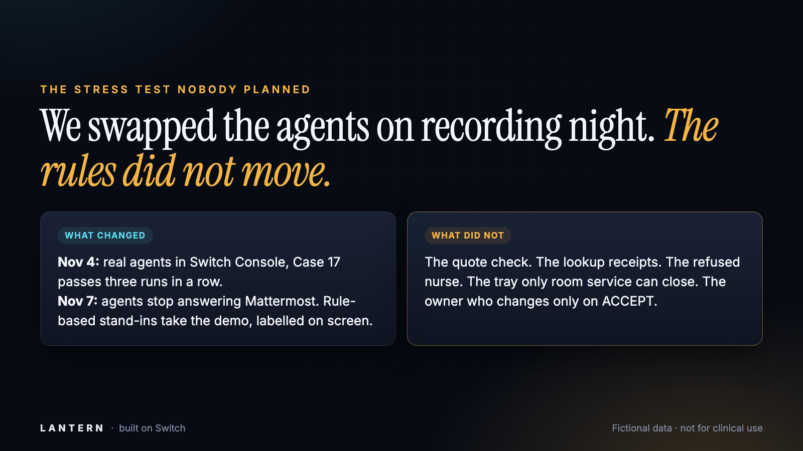

It hurt. It also proved the thesis better than any slide could. **We replaced the agents and not one guardrail moved**, because no guardrail ever lived inside an agent. If your safety depends on your model behaving, a model change is a safety incident. Ours was a bad night.

| In the video | What it really is |
| --- | --- |
| record-bot posts, ✓ checks, refusals, chart changes, task closes, owner changes | **Real**, from one run against a local Mattermost |
| Patients, nurses, doctor, room service | **Scripted**, played by our team's driver |
| intake, care-coordinator, interpreter, scribe | **Stand-ins**, rule-based, labelled on screen |
| Wispr bubbles | **Re-enactment**, labelled; the commands were typed |
| Jira board and Google Calendar | **Real items we created by hand** through our connectors for the demo. The dashboard's tracking rows come from a demo mapping file. Lantern's own Jira and Calendar hooks are tested against fakes only |

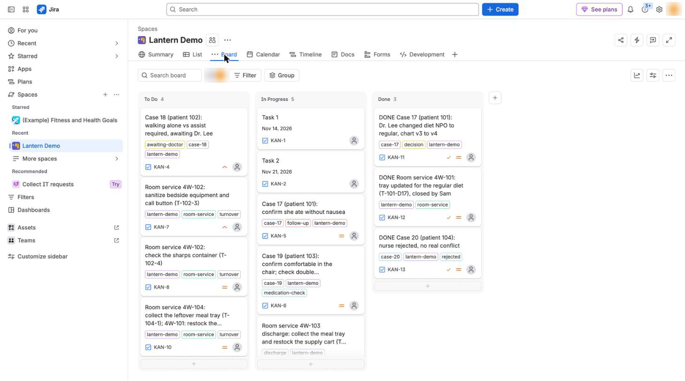

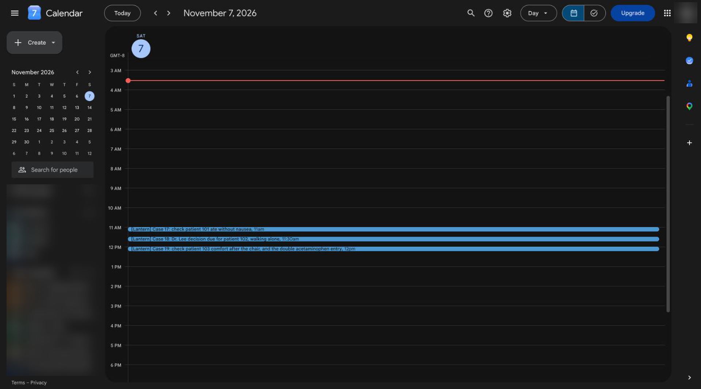

## A ward has no free hands

Every staff command in Lantern is one short, speakable line, designed for [Wispr Flow](https://wisprflow.ai), which works in any text box with no integration code: `CONFIRM Case 17`. `HANDOFF Case 17 open: confirm she ate without nausea`. `REMIND Case 17 in 20 min check she ate`. Whisper Mode fits a 7:00 handoff beside sleeping patients.

And voice changes nothing about power. **Dictation is just a faster keyboard.** A whispered `DECIDE` from a nurse is refused exactly like a typed one, because Lantern checks who posted, not how the words got there.

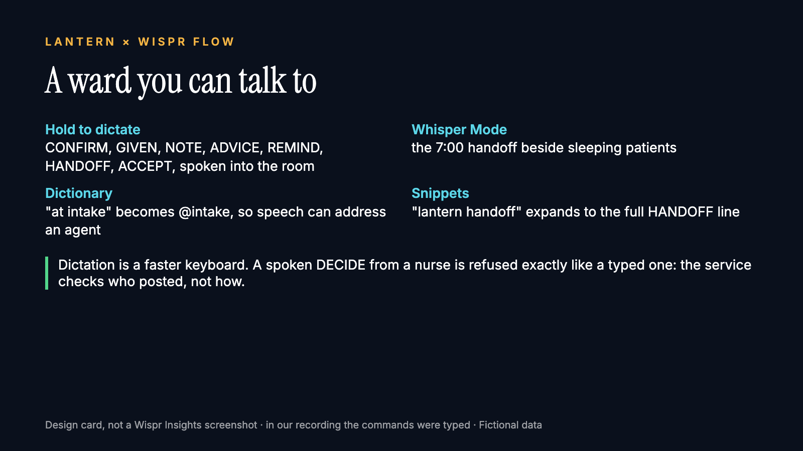

## Why this only works on Switch

Take Switch away and you have a chatbot and a database. Switch gives you what a ward actually needs:

- **Membership as a privacy model.** Which rooms an agent may enter is a setting, not a prompt it might ignore.
- **Agents under their own names, in the staff's own rooms,** answering in the same threads as the people, so every step can be read and audited.
- **One agent across several rooms,** so a case can cross from the nurse station to the doctor and come back.
- **Any coding agent.** Our rebuilt agents run on OpenCode in Switch Console.

What it cost us to learn:

| What happened | Why | The fix |
| --- | --- | --- |
| Agents ignored everything we typed | Switch ignores the Mattermost admin account | Chat as a normal user |
| Couldn't register a custom agent from a script | Console 0.40.1 had no page for an Agent Protocol key | A normal bot account and the REST API |
| The service lost threads agents had started | Switch message ids and Mattermost post ids differ | The service starts every case thread itself and stores both |
| A human @mention worked, a bot's did not | Addressing rules treat them differently | Test the bot path, not just the human path |
| Agents stopped answering at the worst moment | Not found yet; account linking and addressing are the suspects | Keep every rule outside the agents |

## Don't trust us. Check.

| Claim | Evidence |
| --- | --- |
| 98 automated tests pass, no network needed | [`recordings/tests.txt`](https://github.com/sivasuryachandran/Lantern/blob/marketing-assets/recordings/tests.txt) |
| A nurse's `DECIDE` is refused, the chart holds | `tests/test_must_pass.py`, the dashboard's Command audit |
| Invented patient quotes are rejected | `tests/test_must_pass.py` |
| Only room service closes a tray task | The `DONE` check in `lantern/service.py` |
| Every cut, speed change and insert in the video | [`recordings/final/cutlist.md`](https://github.com/sivasuryachandran/Lantern/blob/marketing-assets/recordings/final/cutlist.md) |

Run it yourself in under a minute:

```bash
git clone https://github.com/sivasuryachandran/Lantern && cd Lantern
python3 -m venv .venv && .venv/bin/pip install pyyaml
.venv/bin/python -m unittest discover -s tests   # 98 tests
.venv/bin/python scripts/demo_offline.py         # Case 17, no Mattermost needed
```

## What this doesn't claim

Lantern is not connected to a hospital or an EHR. Its clinical safety is unvalidated, and no nurse has reviewed it yet: we [wrote the questions](https://github.com/sivasuryachandran/Lantern/blob/marketing-assets/docs/NURSE_REVIEW.md) and ran out of time. That is the first thing we'd fix, followed by getting the Switch agents answering end to end, so the next recording needs no stand-ins.

One rule shaped all of it, and we would build it the same way again.

**The agents are allowed to be wrong, because they are not allowed to decide.**
