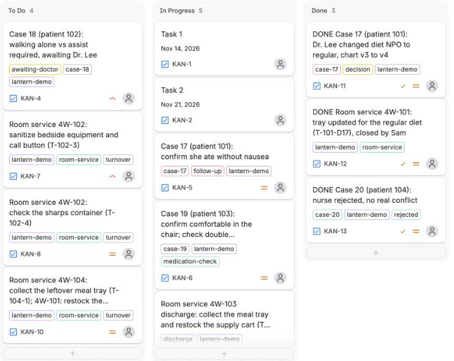

*By Siva Surya Chandran · Flip the Switch Hackathon, November 2026*

> **Fictional patients, a simulated chart, human roles played by our team.** Lantern is a hackathon prototype. It is not a clinical system, not an EHR, and not medical advice.

**Demo video (2:52):** [ADD YOUTUBE LINK] · **Code:** [github.com/sivasuryachandran/Lantern](https://github.com/sivasuryachandran/Lantern)

## The end of a shift

It's 6:40 in the morning and Nurse Ana's shift ends at seven. One patient asked, half an hour ago, whether she can walk to the bathroom alone. The doctor hasn't answered. Ana gave a medicine at 6:05 that the next nurse needs to know about. And Patient 101 has just said something to her bedside tablet, in passing:

> "Can't wait for breakfast. Dr. Lee said it's fine now that my procedure moved."

Her chart still says **NPO**: nothing by mouth.

Nobody did anything wrong. A doctor said something reasonable, the chart hasn't caught up, and in twenty minutes a different nurse takes over. Ana can write a handoff, but writing a handoff is not the same as Ben *accepting* it.

That gap is what Lantern is for. Named AI agents work inside the care team's chat through [Switch](https://docs.switchagents.ai). They notice when a patient's words don't match the chart, carry the question to the right people, and cite every chart fact with a receipt that code checks. **The agents never decide anything.** A nurse confirms what the patient meant, a doctor makes the call, and the next nurse explicitly accepts what is still open.

*What was said. What was confirmed. Who owns what's next.*

## Why this gap matters

The Joint Commission defines a hand-off as "a transfer and acceptance of patient care responsibility achieved through effective communication" (AHRQ PSNet summary of Sentinel Event Alert 58). Note the word *acceptance*: someone has to actually take ownership, not just receive a message. The alert lists wrong-site surgery, delays in treatment, falls and medication errors among the adverse events linked to hand-off failures, and cites a 2016 estimate that communication failures played a part in about 30% of malpractice claims ([Sentinel Event Alert 58](https://www.jointcommission.org/)).

Tools for writing things down already exist. We didn't want to build another scribe. We wanted the moment after something is written down: the patient's words and the record disagree, somebody has to notice, the right person has to decide, and the next shift has to know who owns what's left. That is a coordination problem, and coordination happens in team chat, which is where Switch puts AI agents.

## Nine rooms, one ward

The ward is nine private rooms in Mattermost, connected to agents through Switch:

- **Four patient rooms** (`patient-101` to `patient-104`): the bedside tablets. **No agent is ever a member.**
- **Two staff rooms:** `nurse-station` and `doctor-review`, where people and agents work together.
- **Three feeds:** `orders`, `medication`, `room-service`. Only Lantern's service writes to `orders` and `medication`.

| Who | What they do |
| --- | --- |
| Patients | mention concerns, receive only permitted updates (patient 103 writes Spanish) |
| Nurse Ana / Ben | `CONFIRM` or `REJECT` what a patient meant, record medicines, hand off, accept |
| Dr. Lee | the only one whose `DECIDE` changes the simulated chart |
| Sam / Rita (room service) | close tray and turnover tasks; nobody else can |
| **intake** (agent) | flags a *possible* discrepancy, quoting the patient exactly |
| **care-coordinator** (agent) | carries the case to the doctor, cites chart facts with lookup receipts, briefs the next nurse |
| **interpreter**, **scribe** (agents) | translate both ways, file dictated notes and reminders |
| **record-bot** | plain code, not an AI: opens case threads, checks claims and roles, posts the ✓/⚠ checks, sends fixed patient messages |

Agents notice and coordinate. People confirm and decide. Code determines what counts.

## The case, told as evidence

1. **The bedside.** Patient 101's remark lands in `patient-101`; record-bot carries it to `nurse-station`.
2. **The first agent notices.** `intake` puts her exact words beside the active chart entry (`ord-diet-1`, NPO, v3) and labels it *possible discrepancy*. The service rejects any card whose quote is not an exact substring of her real message.
3. **A person clarifies.** Case 17 opens. Nurse Ana replies `CONFIRM Case 17`.
4. **Receipts.** In `doctor-review`, `care-coordinator` summarises the case. Each cited fact (for example `proc-1 v3 · lookup #2`) is checked by the service against its own lookup log and marked ✓. That ✓ proves a match with a logged value. It does not prove the medicine is right.


5. **The refusal.** Ana tries a `DECIDE` herself. Code refuses it (author, role, room, thread, chart version) and the chart stays at v3. The screenshot above shows her attempt in the thread, and the dashboard counts it under "refused by code".
6. **The doctor decides.** Dr. Lee's `DECIDE Case 17 v3 diet=regular` plus `EXPLAIN:` is the only event that moves the chart to v4. The patient receives Dr. Lee's own words, attributed, with "Following up: nurse-ana" under them.


7. **The decision becomes work.** The diet change opens a tray task in `room-service`. A nurse's `DONE` is refused. Sam's is accepted.
8. **The shift doesn't erase the work.** Ana posts `HANDOFF`; the coordinator briefs Ben with sources, including the 6:05 dose; nothing changes owner until Ben posts `ACCEPT Case 17`. Then the owner flips to Ben everywhere.


## The rest of the ward

- **Spanish.** Patient 103 writes in Spanish; the interpreter shows the English beside the original, and can read the translation aloud. The clinician still owns the answer.
- **Medicines given are not orders.** `GIVEN` records that a nurse says a dose was given. A second entry for the same medicine is flagged as a possible double entry; both stay visible.
- **Speech becomes the right kind of entry.** `NOTE` changes nothing else. `ADVICE` records the doctor's advice plus a *draft* `DECIDE` she must send herself. `REMIND` posts back when due.
- **Discharge.** `DISCHARGE` opens a turnover checklist; `READY` reports whether every task is closed.
- **Mission control** is a read-only dashboard of 14 panels (patients, cases, evidence ledger, simulated chart versions, medicines, room tasks, translations, reminders, tracking, command audit). It cannot write to the chart.
- **Work leaves the chat.** Follow-ups become a Jira task and a Calendar event, linked back to the thread. These are real items in our test workspace:



![the real Google Calendar with the three [Lantern] follow-up events](https://raw.githubusercontent.com/sivasuryachandran/Lantern/marketing-assets/docs/blog-assets/proof-google-calendar.png)

The dashboard lists both with their command audit:


## Lantern × Wispr Flow

Nurses don't have free hands, and Wispr Flow works in any text box, including Mattermost, with no integration code. Every staff command is a short, speakable line (`CONFIRM Case 17`, `HANDOFF Case 17 open: …`), and Whisper Mode fits a quiet 7:00 handoff. The hard rule is the same with voice: dictation is just a faster keyboard, and a spoken `DECIDE` from a nurse is refused exactly like a typed one, because the service checks *who posted*, not how they typed. In our recording the commands were typed by the driver; the voice design is documented in [docs/WISPR.md](https://github.com/sivasuryachandran/Lantern/blob/marketing-assets/docs/WISPR.md). [ADD: your Wispr Insights screenshot.]

## Why Switch is the backbone

Switch turns each channel into a room where people and AI teammates work together. Agents show up under their own names, one agent can sit in several rooms, and room membership is the privacy model: the most important design decision we made was *which rooms an agent may enter*, and in Switch that is a setting, not code. Without it we would have a chatbot and a database: no agents working in the staff's own rooms, no agent-to-agent handoff in plain sight, no isolation between patient rooms.

## What we hit

| What happened | Why | What we did |
| --- | --- | --- |
| Agents ignored everything we typed | We chatted as the Mattermost admin, and Switch ignores that account | used a normal user |
| Couldn't register a custom agent from a script | Console 0.40.1 had no page for an Agent Protocol key | used a Mattermost bot account and its REST API for system posts |
| Service couldn't find a thread an agent started | Switch message ids and Mattermost post ids differ | the service starts every case thread itself and stores both ids |
| **The Console agents didn't answer Mattermost messages at recording time** | we have not found the cause yet (the agents were re-created late; account linking and addressing are the suspects) | the recorded run uses stand-in agents (below) |

## What is real in the demo, and what is not

We'd rather say it than have you find it:

- The record service, record-bot, every ✓ check, refusal, chart change, task close and owner change in the video come from **one real run** against a local Mattermost.
- The humans (patients, nurses, Dr. Lee, room service) are **played by our script**.
- The agents in the recording are **rule-based stand-ins** (`lantern/simagents.py`, captioned "stand-in mode (tests)"), because our two Switch Console agents (`intake`, `care-coordinator`, on OpenCode) were not answering Mattermost messages by the time we recorded. They did run live in Console earlier in the build. `interpreter` and `scribe` exist only as code stand-ins.
- The Wispr bubbles in the video are labelled re-enactments.
- No nurse has reviewed this. We prepared the questions ([docs/NURSE_REVIEW.md](https://github.com/sivasuryachandran/Lantern/blob/marketing-assets/docs/NURSE_REVIEW.md)) and ran out of time.

## Proof you can check

| Claim | Evidence |
| --- | --- |
| 98 automated tests pass, no network | [`recordings/tests.txt`](https://github.com/sivasuryachandran/Lantern/blob/marketing-assets/recordings/tests.txt) ends `Ran 98 tests in 4.967s · OK` |
| A nurse's `DECIDE` is refused and the chart stays put | `tests/test_must_pass.py`, plus the "refused by code" count and Command audit on the dashboard |
| A quote that isn't in the patient's message is rejected | `tests/test_must_pass.py` (quote must be an exact substring of the original post) |
| Only room service can close a tray task | `DONE` check in `lantern/service.py`; refused in the run (`scripts/ward_scenarios.py`) |
| No agent is in any patient room | `config/roles.yaml` room membership; `patient-102`'s account gets 403 reading `patient-101` |
| Same run, step by step | [`recordings/final/cutlist.md`](https://github.com/sivasuryachandran/Lantern/blob/marketing-assets/recordings/final/cutlist.md) and `shotlist_actual.md` |
| Real Jira and Calendar items | the screenshots above (fictional data) |

Reproduce it:

```bash
git clone https://github.com/sivasuryachandran/Lantern && cd Lantern
python3 -m venv .venv && .venv/bin/pip install pyyaml
.venv/bin/python -m unittest discover -s tests        # 98 tests, no network
.venv/bin/python scripts/demo_offline.py              # the whole Case 17 flow, no Mattermost
```

With a local Mattermost (Switch Console runs one for you), `scripts/start.sh` starts the record service and dashboard on `127.0.0.1:8099`, and `scripts/ward_scenarios.py` plays the human roles for a full day on the ward.

## What we learned

1. **Room membership is your privacy model.** Switch makes it a setting.
2. **Agents are great at noticing and carrying, not deciding.** Every write that matters goes through deterministic checks.
3. **`@mention`s between agents are a real workflow primitive.** intake → care-coordinator → doctor is just chat, so people can read and audit every step.
4. **Test the bot path, not just the human path.** A human `@mention` waking an agent doesn't prove a service-posted message will.
5. **Show the posts, not just the dashboard.** If a card can't be traced to a post, it shouldn't be there.

## What we'd do next

Put it in front of nurses (which discrepancies are worth surfacing, and which are noise). Read a real record, read-only, under proper governance: the chart stays the authority on orders and Lantern owns only concerns, decisions and follow-up ownership. One-tap Mattermost buttons for `CONFIRM` and `ACCEPT` with platform-verified identity. And get the Switch agents answering Mattermost end to end, so the next recording needs no stand-ins.

One shift, four patients, nine rooms. A doctor makes the decision and the next nurse accepts the work. Switch is where the collaboration happens. Lantern keeps the trail.

## Sources

- [Switch documentation](https://docs.switchagents.ai)
- The Joint Commission, *Sentinel Event Alert 58: Inadequate hand-off communication*
- AHRQ PSNet summary of Sentinel Event Alert 58
